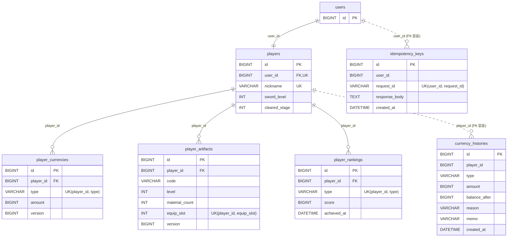

# Swordmaster-Server

## 프로젝트 소개
2026 내일배움캠프 단기심화 최종프로젝트 서버

9조(강화이구조) 팀프로젝트 서버

[클라이언트 주소]
https://github.com/upgrade-29/swordmaster-client

## 개발기간
26.09.23 ~ 26.10.21 (기획기간 포함)

## 개발환경 및 기술 스택

- Intellij

    Spring Boot(4.1.1) (Java, JPA, MySQL, RDS)
  
    JDK : 21.amazon

- Docker

- Postman

- AWS

    123123

    123123
    

## 개발자 소개
- 김관영( https://github.com/UR-KGY ) : 상점 및 CICD
- 오수호( https://github.com/OHSUHO ) : 전투
- 이훈( https://github.com/Lee-Hun97 ) : 로그인 및 채팅
- 허준혁 ( https://github.com/slshan0597 ) : 플레이어 기반 DB 설계, 장비 강화, 랭킹 기록

## 주요 기능

  
유지보수 및 배포

  

여기에 숨겨둘 텍스트, 이미지, 코드 등을 작성합니다.(첫줄을 남겨놓아야 줄바꿈이 가능함 <- 이유는 모름)
  

  
인증과 인가

  

    
...  
회원가입과 로그인, WebSocket의 통신을 제외한 모든 요청에는 JWT인증이 필요하다.

로그인 성공 시 서버는 클라이언트에게 **JWT**(AccessToken + RefreshToken)를 반환해주고, (RefreshToken 미구현)

클라이언트가 서버의 api를 호출하는 경우 **filter기능**을 통해서 JWT를 통한 인증을 먼저 거치게된다.

AccessToken 만료 직전 클라이언트는 서버에 재연결을 요청하여 새로운 JWT를 전달받아야한다. (재연결 미구현)

모바일 환경이기에 만료 직전 클라이언트가 가동을 안하는 경우를 대비해, 재연결 시 만료 직전 시간을 비교하여 재연결을 요청해야한다.

**WebSocket** 통신의 경우 처음 **STOMP connect**에만 JWT가 필요하고, AccessToken 만료 직전 재발급 시 자동으로 재연결을 요청해야한다.
  

  
허준혁 - 플레이어의 기반 DB(재화 등) 설계, 장비(검, 아티팩트) 강화, 랭킹 기록

  

| 기능 | 구현 내용 | 상세 |
| --- | --- | --- |
| 공통 | 패키지 구조 설계, `ErrorCode` 기반 일관된 오류 응답, 구글 시트 게임 데이터 로딩·검증, 타입이 정해진 상수 테이블 | [common](docs/common.md) |
| 플레이어 | 플레이어 생성·조회, 닉네임 중복과 동시 생성 방지 | [player](docs/player.md) |
| 재화 | 골드·다이아 지급·차감, 모든 변동을 잔액과 함께 기록, 매일 잔액과 기록 합계 검증 | [currency](docs/currency.md) |
| 검 | 확률 강화(성공 +1, 실패 시 파괴)와 판매, 요청 레벨 검증 | [equipment-sword](docs/equipment-sword.md) |
| 아티팩트 | 재료·골드 강화, 3개 슬롯 장착·해제·이동, 능력치 시트 분리 | [equipment-artifact](docs/equipment-artifact.md) |
| 멱등성 | `requestId`로 같은 요청의 중복 처리 방지, 동시 요청은 유니크 제약으로 차단 | [idempotency](docs/idempotency.md) |
| 랭킹 | 검 최고 단계·스테이지·전투력 랭킹. DB 원본 + Redis 실시간 랭킹·일일 집계본, 집계본 기준 예상 순위 | [ranking](docs/ranking.md) |

**ERD**
 

 
- 실선은 외래 키, 점선은 ID만 저장하는 관계
- 기획 데이터는 구글 시트에 있고 코드가 값으로 연결, `players.sword_level` → `swords.level`, `player_artifacts.code` → `artifacts.code`이며, 아티팩트 능력치는 `artifact_stats`, 강화 비용은 `artifact_enhance`에서 검색
- 랭킹 조회용 사본은 Redis에 존재 ([ranking](docs/ranking.md)).
 
**핵심 설계**
 
- **중복·동시 요청에 안전한 처리:** 재화가 바뀌는 요청은 멱등성 키로 한 번만 처리하고, 재화·아티팩트는 낙관적 락(`Version`), 장착 슬롯은 유니크 제약으로 보호
- **재화 추적:** 지급·차감을 변동량과 잔액으로 남기고, 매일 잔액과 기록 합계를 비교해 불일치 여부 검사
- **기획 데이터 분리:** 강화 확률·비용·능력치를 범용 파싱 테이블을 통해 구글 시트에서 읽고, 서버 시작 시 검증해 잘못된 값이 있으면 기동을 정지
- **랭킹 정합성과 확장성:** 기록은 DB upsert 한 번으로 비교·저장하고 커밋 후에만 Redis에 반영, 조회는 Redis Sorted Set으로 처리해 인원이 늘어도 순위 계산이 빠름

  

  
전투 및 보상

  

  여기에 숨겨둘 텍스트, 이미지, 코드 등을 작성합니다.(첫줄을 남겨놓아야 줄바꿈이 가능함 <- 이유는 모름)

  

