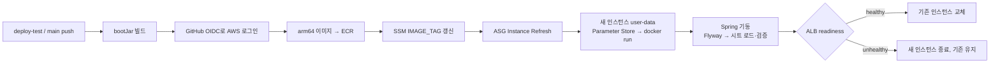
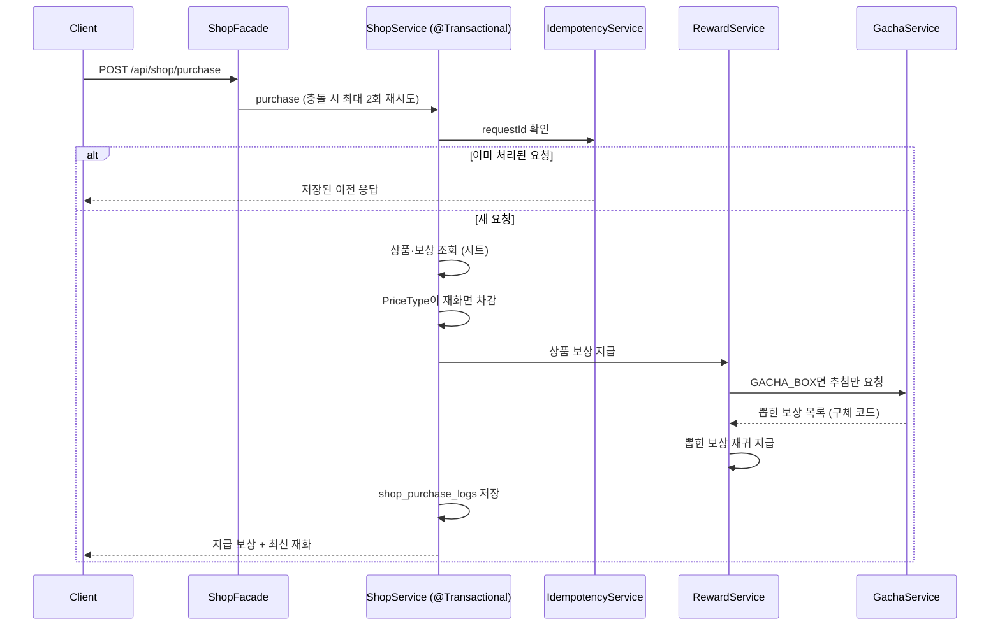
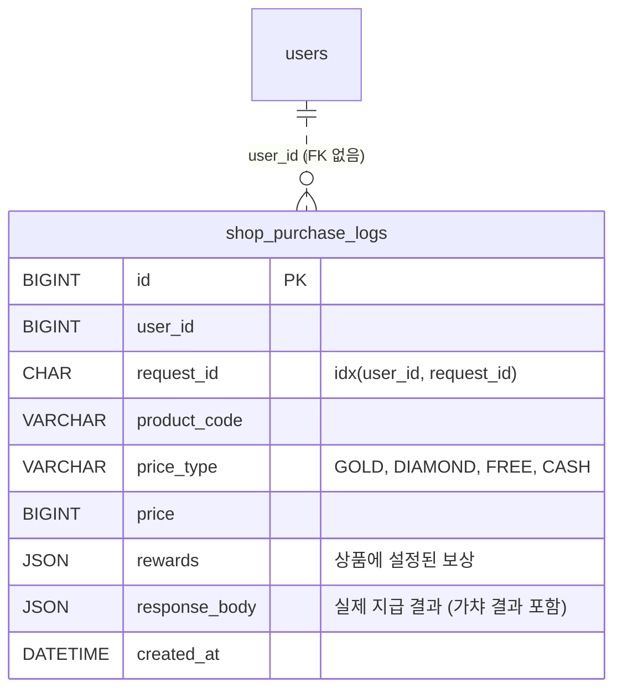
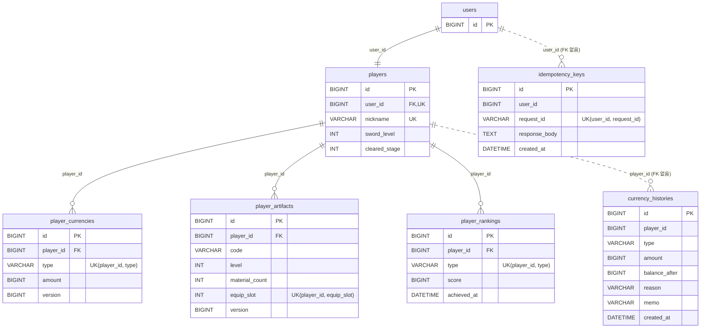

# Swordmaster-Server

## 프로젝트 소개
2026 내일배움캠프 단기심화 최종프로젝트 서버

9조(강화이구조) 팀프로젝트 서버

[클라이언트 주소]
https://github.com/upgrade-29/swordmaster-client

## 개발기간
26.09.23 ~ 26.10.21 (기획기간 포함)

## 개발환경 및 기술 스택

- Intellij

    Spring Boot(4.1.1) (Java, JPA, MySQL, RDS)
  
    JDK : 21.amazon

- Docker

- Postman

- AWS

    

## 개발자 소개
- 김관영( https://github.com/UR-KGY ) : 상점 및 CICD
- 오수호( https://github.com/OHSUHO ) : 전투
- 이훈( https://github.com/Lee-Hun97 ) : 로그인 및 채팅
- 허준혁 ( https://github.com/slshan0597 ) : 플레이어 기반 DB 설계, 장비 강화, 랭킹 기록

## 주요 기능
<details>
  <summary>유지보수 및 배포</summary>
  <div markdown="1">

### 접속 주소

| 용도 | 주소 |
| --- | --- |
| REST API | `https://api.upgrade-29.com` |
| WebSocket (STOMP) | `wss://api.upgrade-29.com/ws` |
| 헬스체크 | `https://api.upgrade-29.com/actuator/health/readiness` |

- 도메인: 가비아 `upgrade-29.com`, `api` → ALB CNAME / 인증서: ACM `api.upgrade-29.com` (DNS 검증, 자동 갱신)
- ALB 기본 주소(`….elb.amazonaws.com`)로는 HTTPS 불가 (인증서 이름 불일치) → 항상 도메인 사용
- HTTP(80)는 클라이언트 전환 완료 전까지 임시 허용, 전환 후 차단 예정 (`ws://`는 리다이렉트를 따라가지 못함)
- 가비아의 **ACM 검증용 CNAME은 삭제 금지** (인증서 자동 갱신에 필요)

### 인프라 구조

```
사용자 ─443/80─▶ ALB(퍼블릭) ─8080─▶ EC2(프라이빗, ASG) ─3306─▶ RDS
                                                     └─6379─▶ ElastiCache
EC2 ──▶ NAT ──▶ ECR / SSM Parameter Store / Google Sheets
```

| 구성 | 내용 |
| --- | --- |
| 서버 | EC2 Auto Scaling Group(`swordmaster-asg`) + ALB, 시작 템플릿 user-data로 컨테이너 실행 |
| 이미지 | Docker `linux/arm64` → Amazon ECR, 태그 `vYYYYMMDD-HHmm-커밋7자리` (최근 10개 보관) |
| DB / 캐시 | RDS(MySQL 8, 단일 AZ), ElastiCache(Valkey, SSL) |
| 스키마 | Flyway 마이그레이션 + Hibernate `validate` |
| 설정·비밀값 | SSM Parameter Store `/swordmaster/prod/*` |
| 로그 | CloudWatch Logs `/swordmaster/prod/app` (스트림 = 인스턴스 ID), 초기화 로그 `/var/log/swordmaster-init.log` |

| 보안 그룹 | 인바운드 |
| --- | --- |
| `alb-sg` | 80, 443 ← 전체 |
| `app-sg` | 8080 ← `alb-sg` (22번 없음) |
| `rds-sg` | 3306 ← `app-sg`, `bastion-sg` |
| `valkey-sg` | 6379 ← `app-sg`, `bastion-sg` |

- RDS·ElastiCache는 프라이빗 → 로컬 PC에서 직접 접속 불가 (의도한 설계)
- 앱 서버 접속은 SSM Session Manager (키·22번 불필요)

### CI/CD



- 새 인스턴스가 healthy가 되기 전까지 기존 인스턴스 유지 (`MinHealthyPercentage 100`, 워밍업 180초)
- **CI 성공 = 교체 요청 접수.** 실제 결과는 ASG *인스턴스 새로 고침*·*활동* 탭과 CloudWatch 로그로 확인
- 새 인스턴스는 부팅 시 `IMAGE_TAG`를 읽으므로, CI의 refresh 단계만 실패해도 이후 뜨는 인스턴스는 최신 이미지 사용
- Instance Refresh는 **한 번에 하나** → 진행 중이면 `InstanceRefreshInProgress`. 진행 중 refresh 완료/취소(`Cancelled` 확인) 후 재시작

### 운영 환경변수 (Parameter Store `/swordmaster/prod/`)

| 이름 | 용도 |
| --- | --- |
| `IMAGE_TAG` | 배포 이미지 태그 (CI가 갱신) |
| `DB_HOST`, `DB_USERNAME`, `DB_PASSWORD` | RDS 접속 |
| `REDIS_HOST` | ElastiCache 접속 |
| `JWT_SECRET` | JWT 서명 (교체 시 기존 토큰 모두 무효 → 재로그인) |
| `GOOGLE_WEB_CLIENT_ID` | 구글 로그인 토큰 검증 |

**환경변수 추가 절차** (하나라도 빠지면 부팅 실패)

1. Parameter Store에 `/swordmaster/prod/KEY` 생성 — 값은 **실제 값** (`${KEY}` 입력 금지)
2. 시작 템플릿 새 버전: user-data에 `KEY=$(retry getp KEY)` + `-e KEY="$KEY" \` 추가 → **기본 버전 지정** (ASG는 `Default` 사용)
3. `application-prod.properties`에 `KEY=${KEY}` 추가
4. 배포 후 새 인스턴스 태그 `aws:ec2launchtemplate:version`이 새 버전인지 확인

> user-data는 `set -euo pipefail` → 파라미터 하나라도 못 읽으면 컨테이너 실행 전에 중단

### 헬스체크

| 항목 | 값 |
| --- | --- |
| ALB 대상 그룹 경로 | `/actuator/health/readiness` |
| Security 허용 | `FilterConfig`의 `GET /actuator/health/**` permitAll |
| ASG 헬스체크 | ELB 기준, 유예 180초 |
| 등록 해제 지연 | 30초 |

- `/actuator/health`(DB·Redis 포함) 대신 readiness를 쓰는 이유: DB·Redis 일시 장애 시 **멀쩡한 서버까지 교체가 반복**되는 연쇄 장애 방지. 외부 의존성 장애는 5xx 알람으로 감지
- 경로 변경 순서: ① 새 경로 허용 코드 배포 → ② 새 경로 200 직접 확인 → ③ 대상 그룹 경로 변경 (순서가 바뀌면 401 → 전 서버 Unhealthy → 교체 반복)

### 모니터링·알림

| 알람 | 조건 | 의미 |
| --- | --- | --- |
| `swordmaster-no-healthy-host` | Healthy 대상 0대, 2분 | 서비스 중단 |
| `swordmaster-target-5xx` | 앱 5xx 5분간 5건 이상 | 앱 에러 (DB·Redis 장애 포함) |
| `swordmaster-rds-low-storage` | RDS 남은 공간 2GB 미만 | 디스크 부족 임박 |

- 모두 SNS `swordmaster-alerts` → 이메일 (경보·복구 둘 다)
- 로그 검색어: `ERROR`, `Exception`, `APPLICATION FAILED`, `Started`, `Migrating`

### 운영 규칙

- **마이그레이션 파일명** `VyyyyMMdd_HHmm__설명.sql` (작성 시점). 병합 시 develop 최신 버전보다 작으면 운영 Flyway validate 실패 → 파일명 재조정
- **시트 컬럼·값 변경 순서: 코드 배포 → 시트 변경.** 서버는 부팅 시 시트를 엄격 검증하므로 코드가 모르는 열·값이 있으면 기동 중단
- **Parameter Store·시트는 부팅 시 한 번만 읽음** → 값만 바꾸면 실행 중 서버에 미반영, 아래 재배포 필요
- **마이그레이션이 포함된 배포는 이미지 롤백 금지** → 수정 커밋으로 재배포

### DB 접근·데이터 보호

| 항목 | 내용 |
| --- | --- |
| 삭제 방지 | 켜짐 |
| 자동 백업 | 1일 (프리 플랜 상한) |
| 수동 스냅샷 | 위험 작업 직전 `before-작업-날짜` (컬럼·테이블 삭제 마이그레이션 배포 전 필수) |
| 접근 방법 | 바스티온 SSH 터널(`127.0.0.1:3307`) 또는 SSM 포트 포워딩 |
| 팀원 계정 | 조회 전용 계정 별도 발급 (`GRANT SELECT ON swordmaster.*`) |

**배포 실패 시 확인 순서:** ASG 활동 탭 → 새 인스턴스 태그(템플릿 버전) → CloudWatch 해당 인스턴스 스트림 → (스트림 없으면) Session Manager로 `/var/log/swordmaster-init.log`

### 현재 제약

| 제약 | 이유 | 대응 |
| --- | --- | --- |
| 서버 1대 고정 (스케일링 정책 비활성) | STOMP `SimpleBroker`가 서버 메모리 → 2대면 채팅이 갈림 | 외부 브로커(Redis Pub/Sub 등) 적용 후 재활성화 |
| 배포 중 WebSocket 끊김 | 인스턴스 교체 (드레이닝 30초) | 클라이언트 자동 재연결 |
| RDS 단일 AZ | 비용 | 출시 시 Multi-AZ 검토 |
| `deploy-test`·`main`이 같은 ASG에 배포 | 임시 운영 | main 배포 안정화 후 deploy-test 트리거 제거 |
  </div>
</details>

<details>
  <summary>상점 구매 기능</summary>
  <div markdown="1">

### 담당 기능

| 기능 | 구현 내용 |
| --- | --- |
| 상점 구매 | 상품 조회 → 결제 → 보상 지급 → 구매 기록을 **하나의 트랜잭션**으로 처리 |
| 결제 방식 | `PriceType` (GOLD, DIAMOND, FREE, CASH) — 재화 결제만 차감, FREE는 차감 없이 지급, CASH는 미구현이라 시트 검증에서 차단 |
| 보상 지급 | `RewardService`가 골드·다이아·아티팩트·가챠 보상을 지급, 상점 외 기능도 공통 사용 |
| 가챠 | 가중치 추첨(`SecureRandom`), 추첨(`GachaService`)과 지급(`RewardService`) 분리 |
| 가챠 등급 랜덤 | ARTIFACT 행의 rewardCode가 비어 있으면 artifact 시트에서 같은 grade인 아티팩트 중 균등 추첨 |
| 중복 결제 방지 | 클라이언트 `requestId`로 공용 멱등성 모듈을 거쳐 같은 요청은 1회만 처리 (보관 1일) |
| 동시성 | 낙관적 락 충돌·데드락(1213)은 최대 2회 재시도, 그 외 락 대기 초과는 즉시 503 (`ShopFacade`) |
| 기획 데이터 | 구글 시트(`shopProducts`, `shopProductRewards`, `gachaEntry`)를 부팅 시 로드·검증 |
| CI/CD | GitHub Actions → ECR → ASG Instance Refresh 무중단 배포 (유지보수 및 배포 참고) |

### API

**`POST /api/shop/purchase`** (JWT 필요)

```json
// 요청
{
  "requestId": "3f6c1e2a-...-uuid",   // 클라이언트가 구매 시도마다 생성, 재시도 시 같은 값
  "productCode": "ARTIFACT_LEGENDARY_10"
}
```

```json
// 응답 200
{
  "rewards": [                          // 실제 지급된 보상 (가챠는 뽑힌 결과로 펼쳐짐)
    { "rewardType": "ARTIFACT", "rewardCode": "GIANT_SHEATH", "amount": 1 },
    { "rewardType": "GOLD", "rewardCode": null, "amount": 500 }
  ],
  "currencies": { "gold": 1500, "diamond": 26000 }   // 지급 후 최신 재화
}
```

| 상황 | 응답 |
| --- | --- |
| 같은 `requestId` 재요청 | 처음 처리한 **같은 응답** 반환 (재결제 없음) |
| 없는 상품 | 404 `상품을 찾을 수 없습니다.` |
| 재화 부족 | 재화 모듈의 부족 에러 (차감·지급 모두 롤백) |
| 동시 요청 충돌 재시도 초과 | 503 `요청이 몰려 처리하지 못했습니다. 잠시 후 다시 시도해 주세요.` |

- 응답의 `rewardCode`는 항상 **실제 코드**로 내려감 → 클라이언트는 빈 코드 처리 불필요
- 클라이언트는 응답이 불확실(타임아웃 등)하면 **같은 `requestId`로 재요청**

### 구매 처리 흐름



### 가챠 추첨

1. 같은 `gachaCode` 행 중 **weight 비율**로 한 행 선택
2. 선택된 행이 *ARTIFACT + rewardCode 빈칸 + grade* 이면 artifact 시트에서 **같은 등급 아티팩트 중 균등 추첨**

```
아티팩트 1종 확률 = (행 weight ÷ 같은 gachaCode weight 합) × (1 ÷ 해당 등급 아티팩트 수)
```

| 구분 | 값 |
| --- | --- |
| 상자 여는 횟수 | `shopProductRewards`의 GACHA_BOX amount (최대 10) |
| 등급 랜덤 행 amount | 1 고정 (결과 개수 = 상자 횟수) |
| 지정 행의 grade | 지급에 사용되지 않음 (참고 표시) |
| 등급별 후보 | 부팅 시 `ArtifactTable`에서 미리 묶어 Pool에 보관 → 추첨 중 시트 재조회 없음 |

- artifact 시트에 같은 등급이 추가·삭제되면 **확률이 자동으로 바뀜** (예: LEGENDARY 4종 → 5종이면 각 25% → 20%)
- 한 상자에 지정 행과 같은 등급 랜덤 행이 함께 있으면 그 아티팩트 확률은 **두 경로의 합**

### 데이터 모델



- 상품·보상·가챠 정의는 DB가 아닌 **구글 시트**에 있고 코드 값으로 연결

### 기획 시트 규칙

| 시트 | 규칙 |
| --- | --- |
| 공통 | 헤더(첫 행) 변경 금지 — 필요 시 **코드 배포 → 시트 변경** / 선택값 대문자 / "없음"은 빈칸 |
| `shopProducts` | `GOLD`·`DIAMOND`는 price > 0, `FREE`는 price = 0, `CASH`는 현재 사용 불가 |
| `shopProductRewards` | 재화(GOLD·DIAMOND)는 rewardCode 빈칸 / GACHA_BOX의 rewardCode = gachaCode, amount = 상자 횟수 |
| `gachaEntry` | 아래 표 |

| gachaEntry 용도 | rewardType | rewardCode | grade | amount |
| --- | --- | --- | --- | --- |
| 재화 | GOLD / DIAMOND | 빈칸 | `NONE` | 지급량 |
| 지정 아티팩트 | ARTIFACT | 아티팩트 코드 | 무시됨 | 지급 개수 |
| 등급 랜덤 | ARTIFACT | **빈칸** | 등급 (`NONE` 제외) | **1** |

- 가챠 결과에 `GACHA_BOX` 금지 (무한 재귀 방지)
- 같은 gachaCode 안에 같은 보상 행 중복 금지

### 핵심 설계

- **한 번의 결제, 한 번의 지급:** 차감·지급·기록이 한 트랜잭션 → 중간 실패 시 전부 롤백, 멱등성 키로 네트워크 재시도에도 중복 결제 없음
- **결제 방식과 재화의 분리:** 지갑 재화(`CurrencyType`)와 가격표 결제 방식(`PriceType`)을 분리 → 무료·현금 결제를 재화 로직 수정 없이 추가
- **추첨과 지급의 분리:** 가챠는 결과 목록만 만들고 지급은 기존 보상 경로 재사용 → 등급 랜덤 추가 시 지급 코드 변경 없음
- **기획 데이터 부팅 검증 (fail-fast):** 결제 방식별 가격, 재화 보상 코드, 아티팩트 코드 존재, 등급 후보 수, 등급 랜덤 amount 등을 시작 시 검사하고 에러를 모아 한 번에 출력 → 잘못된 데이터가 운영에 노출되지 않음
- **구매 기록 보존:** 상품 정의(`rewards`)와 실제 지급 결과(`response_body`)를 함께 저장 → 문의·정산 대응

### 향후 과제

| 항목 | 내용 |
| --- | --- |
| 구매 한도 | FREE 다이아 상품은 현재 무제한 수령 가능 → 현금 결제 구현 시 대체 |
| 현금 결제 (IAP) | Google Play 영수증 검증, `iap_receipts` 테이블, consume 처리 설계 (미구현) 구현 시엔 기존 서비스와 로직 분리(구글 서버와 통신이 문제) |
  </div>
</details>

<details>
  <summary>인증과 인가</summary>
  <div markdown="1">
    
### 구현 개요

REST API는 Spring Security 필터에서 인증과 권한을 검증하며,
실시간 통신은 WebSocket(STOMP)의 연결 인증과 송수신 경로 제한을 통해 보호합니다.

일반·게스트·Google 로그인을 하나의 사용자 인증 구조로 통합하고,
Access Token과 Refresh Token을 이용한 로그인 유지 기능을 구현했습니다.

### 주요 기능

| 구분 | 구현 내용 |
| --- | --- |
| 일반 로그인 | 이메일 기반 회원가입, 비밀번호 해시 저장 및 로그인 검증 |
| 게스트 로그인 | 별도 회원가입 없이 계정·플레이어 생성, 임의 닉네임 부여 |
| Google 로그인 | 서버에서 Google ID Token 검증 후 사용자 식별 및 로그인 처리 |
| 계정 연결 | 기존 게임 계정에 Google 로그인 수단을 연결하여 사용자 ID와 게임 데이터 유지 |
| API 인증 | JWT의 서명·만료 시각 검증 후 사용자 인증 정보 구성 |
| 관리자 인가 | DB에 저장된 사용자 역할을 기준으로 관리자 API 접근 제한 |
| 로그인 유지 | Refresh Token 검증 후 Access Token과 Refresh Token 재발급 |
| 로그아웃 | 서버에 저장된 Refresh Token을 삭제하여 이후 재발급 차단 |
| 전체 채팅 | 인증된 사용자 간 실시간 메시지 송수신 |
| 시스템 알림 | 관리자 전체 공지, 검 강화 성공 알림, 사용자별 시스템 알림 |
| 접속 시간 알림 | 연결별 접속 시간을 추적하여 1시간 간격으로 휴식 안내 |

### 인증 및 토큰 관리

#### REST API 인증

- 회원가입·로그인·토큰 재발급과 지정된 공개 경로를 제외한 API는 인증이 필요합니다.
- 클라이언트는 `Authorization: Bearer <AccessToken>` 헤더로 토큰을 전달합니다.
- 인증 필터는 토큰의 서명과 만료 시각을 검증하고, DB에서 사용자와 역할을 확인합니다.
- 인증된 사용자 ID를 서버에서 사용하여 요청 본문의 사용자 정보에 의존하지 않도록 구성했습니다.
- HTTP 세션을 생성하지 않는 `STATELESS` 방식으로 요청을 처리합니다.
- `/api/admin/**` 경로는 `ADMIN` 권한을 가진 사용자만 접근할 수 있습니다.

#### Access Token · Refresh Token

| 항목 | Access Token | Refresh Token |
| --- | --- | --- |
| 용도 | API 요청 및 STOMP 연결 인증 | 로그인 유지 및 토큰 재발급 |
| 형식 | 서명된 JWT | 보안 난수 기반 토큰 |
| 기본 유효기간 | 1시간 | 14일 |
| 서버 저장 | 토큰 자체는 저장하지 않음 | SHA-256 해시와 만료 시각 저장 |

- Refresh Token 원문은 DB에 저장하지 않고 클라이언트에 전달합니다.
- 재발급 시 두 토큰을 함께 갱신하는 **Refresh Token Rotation**을 적용했습니다.
- 갱신이 완료된 이전 Refresh Token은 이후 재발급에 사용할 수 없습니다.
- 사용자당 하나의 Refresh Token을 관리하여, 새 로그인 시 기존 Refresh Token을 교체합니다.
- 로그아웃 시 Refresh Token을 삭제합니다. 이미 발급된 Access Token은 만료 시점까지 유효합니다.

### Google 로그인 및 게스트 계정 연결

- 클라이언트가 전달한 Google ID Token을 서버에서 검증합니다.
- Google의 고유 식별자 `sub`를 기준으로 사용자를 구분하고, 이메일은 부가 정보로 사용합니다.
- 최초 Google 로그인 시 계정을 생성하고, 이후에는 연결된 계정으로 로그인합니다.
- 게스트 사용자는 기존 계정에 Google 로그인 수단을 연결하여 게임 데이터를 이어갈 수 있습니다.
- 다른 게임 계정에 이미 연결된 Google 계정이나, 기존 연결과 충돌하는 요청은 거부합니다.
- Google 인증 검증은 DB 트랜잭션을 시작하기 전에 수행하여 외부 통신 중 트랜잭션을 유지하지 않도록 구성했습니다.

### 실시간 채팅 및 알림

#### STOMP 연결 인증과 경로 제어

WebSocket의 HTTP 연결과 STOMP 인증을 분리하여,
`/ws` 연결 후 **STOMP CONNECT 프레임에서 JWT를 검증**합니다.

인증 후에는 연결에 저장된 사용자 정보를 사용하며,
클라이언트가 송신·구독할 수 있는 경로를 제한합니다.

| 구분 | 경로 | 용도 |
| --- | --- | --- |
| 연결 | `/ws` | WebSocket 연결 |
| 송신 | `/app/chat/public` | 전체 채팅 전송 |
| 구독 | `/topic/chat/public` | 전체 채팅 수신 |
| 구독 | `/topic/notices` | 전체 공지 및 강화 성공 알림 수신 |
| 구독 | `/user/queue/system` | 개인 시스템 알림 수신 |
| 구독 | `/user/queue/errors` | 채팅 처리 오류 수신 |

- 클라이언트의 STOMP `SEND`는 전체 채팅 처리 경로만 허용합니다.
- 공지·시스템 알림은 서버에서 발행하여 클라이언트의 직접 발행을 차단합니다.
- 발신자 ID와 닉네임은 인증 정보와 DB 조회 결과로 구성하여 발신자 정보 위조를 방지합니다.
- 채팅은 공백이 아닌 최대 500자로 제한하고, 줄바꿈과 제어문자를 차단합니다.
- 채팅 처리 중 발생한 입력·형식 오류는 메시지를 보낸 연결에만 전달합니다.

#### 알림 처리

- 관리자가 등록한 공지를 전체 공지 구독자에게 전달합니다.
- 검 강화 성공 시 닉네임과 강화 단계를 포함한 알림을 전달합니다.
- 사용자별 시스템 알림과 특정 연결에만 보내는 알림을 구분했습니다.
- 접속 시간 알림은 연결별로 관리하며, 연결 종료 시 해당 정보를 제거합니다.

### 모바일 클라이언트 연동 기준

토큰 재발급과 WebSocket 재연결은 별개의 과정으로 처리합니다.

1. 로그인 성공 시 Access Token과 Refresh Token을 보관합니다.
2. 앱 실행·복귀 시 Access Token의 만료 시각을 확인하고, 필요하면 토큰 재발급 API를 호출합니다.
3. 재발급 성공 시 저장된 두 토큰을 모두 새 값으로 교체합니다.
4. WebSocket 연결을 갱신할 때는 새 Access Token으로 STOMP CONNECT를 수행하고 필요한 채널을 다시 구독합니다.
5. Refresh Token이 만료되었거나 유효하지 않으면 로그인 화면으로 이동합니다.

> 서버에는 토큰 발급·재발급 API와 STOMP CONNECT 인증이 구현되어 있습니다.
> 만료 전 자동 갱신, 앱 복귀 시 확인, WebSocket 자동 재연결·재구독은 클라이언트에서 연동해야 합니다.

### 핵심 설계

- **계정과 로그인 수단 분리:** 사용자 계정과 로그인 식별 정보를 분리하여 게스트·일반·Google 로그인을 관리하고, 기존 게임 데이터를 유지한 채 로그인 수단을 연결합니다.
- **토큰 원문 저장 최소화:** Refresh Token은 해시로 저장하고 재발급 시 교체하여, DB에 원문 토큰을 남기지 않습니다.
- **인증과 권한 검증 분리:** JWT로 사용자를 식별하고 DB의 역할 정보로 관리자 접근 권한을 판단합니다.
- **실시간 메시지 신뢰성 확보:** 연결 인증, 송수신 경로 제한, 서버 기준 발신자 정보 구성으로 채팅과 공지의 발행 주체를 통제합니다.

  </div>
</details>

<details>
  <summary>허준혁 - 플레이어의 기반 DB(재화 등) 설계, 장비(검, 아티팩트) 강화, 랭킹 기록</summary>
  <div markdown="1">

| 기능 | 구현 내용 | 상세 |
| --- | --- | --- |
| 공통 | 패키지 구조 설계, `ErrorCode` 기반 일관된 오류 응답, 구글 시트 게임 데이터 로딩·검증, 타입이 정해진 상수 테이블 | [common](docs/common.md) |
| 플레이어 | 플레이어 생성·조회, 닉네임 중복과 동시 생성 방지 | [player](docs/player.md) |
| 재화 | 골드·다이아 지급·차감, 모든 변동을 잔액과 함께 기록, 매일 잔액과 기록 합계 검증 | [currency](docs/currency.md) |
| 검 | 확률 강화(성공 +1, 실패 시 파괴)와 판매, 요청 레벨 검증 | [equipment-sword](docs/equipment-sword.md) |
| 아티팩트 | 재료·골드 강화, 3개 슬롯 장착·해제·이동, 능력치 시트 분리 | [equipment-artifact](docs/equipment-artifact.md) |
| 멱등성 | `requestId`로 같은 요청의 중복 처리 방지, 동시 요청은 유니크 제약으로 차단 | [idempotency](docs/idempotency.md) |
| 랭킹 | 검 최고 단계·스테이지·전투력 랭킹. DB 원본 + Redis 실시간 랭킹·일일 집계본, 집계본 기준 예상 순위 | [ranking](docs/ranking.md) |

**ERD**
 

 
- 실선은 외래 키, 점선은 ID만 저장하는 관계
- 기획 데이터는 구글 시트에 있고 코드가 값으로 연결, `players.sword_level` → `swords.level`, `player_artifacts.code` → `artifacts.code`이며, 아티팩트 능력치는 `artifact_stats`, 강화 비용은 `artifact_enhance`에서 검색
- 랭킹 조회용 사본은 Redis에 존재 ([ranking](docs/ranking.md)).
 
**핵심 설계**
 
- **중복·동시 요청에 안전한 처리:** 재화가 바뀌는 요청은 멱등성 키로 한 번만 처리하고, 재화·아티팩트는 낙관적 락(`Version`), 장착 슬롯은 유니크 제약으로 보호
- **재화 추적:** 지급·차감을 변동량과 잔액으로 남기고, 매일 잔액과 기록 합계를 비교해 불일치 여부 검사
- **기획 데이터 분리:** 강화 확률·비용·능력치를 범용 파싱 테이블을 통해 구글 시트에서 읽고, 서버 시작 시 검증해 잘못된 값이 있으면 기동을 정지
- **랭킹 정합성과 확장성:** 기록은 DB upsert 한 번으로 비교·저장하고 커밋 후에만 Redis에 반영, 조회는 Redis Sorted Set으로 처리해 인원이 늘어도 순위 계산이 빠름

  </div>
</details>

<details>
  <summary>전투 및 보상</summary>
  <div markdown="1">

  여기에 숨겨둘 텍스트, 이미지, 코드 등을 작성합니다.(첫줄을 남겨놓아야 줄바꿈이 가능함 <- 이유는 모름)

  </div>
</details>
