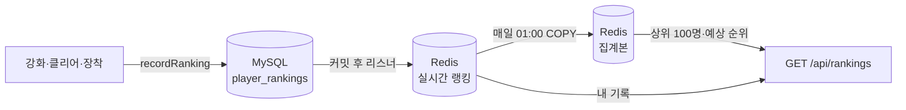

# ranking

랭킹 기록과 조회를 담당, 기록은 DB가 원본이고, Redis에는 조회용 사본(실시간 랭킹과 매일 집계본)을 캐싱

소스 코드: [src/main/java/com/swordmaster/ranking](../src/main/java/com/swordmaster/ranking)



## 클래스

| 클래스 | 역할 |
| --- | --- |
| `RankingController` | API 진입점 |
| `RankingService` | 기록(`recordRanking`, `recordCombatPower`), 조회(상위 100명 + 내 정보 + 인원 + 집계 시각) |
| `RankingRedisStore` | Redis Sorted Set 저장·조회, 점수 합산 |
| `RankingRedisListener` | 커밋 후 DB의 최신 기록을 실시간 랭킹에 반영 |
| `RankingSnapshotJob` | 매일 01:00(한국 시간) 실시간 랭킹을 집계본으로 복사 |
| `RankingRedisRestorer` | 서버 시작 시 실시간 랭킹이 비어 있으면 DB로 복구, 집계본이 없으면 바로 집계 |

## 테이블: player_rankings

| 컬럼 | 타입 | 제약 | 설명 |
| --- | --- | --- | --- |
| `id` | BIGINT | PK | |
| `player_id` | BIGINT | NOT NULL, FK → `players.id` | |
| `type` | VARCHAR(20) | NOT NULL | `SWORD_LEVEL`, `STAGE_CLEARED`, `COMBAT_POWER` |
| `score` | BIGINT | NOT NULL | 랭킹 점수 |
| `achieved_at` | DATETIME(6) | NOT NULL | 지금 점수를 달성한 시각 (동점 순서) |

유니크 `uk_player_rankings_player_type` (`player_id`, `type`). 기록이 생길 때만 행이 생성됨

## Redis 키

| 키 | 자료형 | 내용 |
| --- | --- | --- |
| `ranking:{type}` | Sorted Set | 실시간 랭킹. 멤버 = 플레이어 ID |
| `ranking:{type}:snapshot` | Sorted Set | 집계본 (상위 목록, 예상 순위, 인원) |
| `ranking:{type}:snapshot:updated-at` | String | 마지막 집계 시각 (밀리초) |

Redis 점수는 `기록 × 10^10 + (10^10 − 1 − 경과 시간)`, 경과 시간은 2026-01-01부터 0.01초 단위이므로, 기록이 높을수록, 같으면 먼저 달성할수록 앞섬, 기록은 약 90만, 기간은 약 3년까지 담을 수 있음

## API

| 메서드 | 경로 | 요청 | 응답 |
| --- | --- | --- | --- |
| GET | `/api/rankings?type=SWORD_LEVEL` | `type` 필수 | `RankingResponse` |

```json
{ "rankings":  [ { "rank": 1, "nickname": "검객", "score": 15 } ],
  "me":        { "rank": 37, "nickname": "나", "score": 9 },
  "total":     1580,
  "updatedAt": "2026-10-14T16:00:00Z" }
```

- `rankings`: 집계본 기준 상위 100명
- `me.score`: 실시간 최신 기록 
- `me.rank`: 집계본 기준 예상 순위, 0이면 기록 없음
- `total`: 집계본 인원 (내 예상 순위보다 작지 않게 맞춤)
- `updatedAt`: 집계 전이면 `null`.

## 규칙

| 종류 | 기록 시점 | 저장 방식 |
| --- | --- | --- |
| `SWORD_LEVEL` | 검 강화 | 더 높을 때만 (`upsertIfHigher`) |
| `STAGE_CLEARED` | 스테이지 클리어 (전투) | 더 높을 때만 (`upsertIfHigher`) |
| `COMBAT_POWER` | 검 강화·판매, 아티팩트 강화·장착·해제 | 항상 덮어씀 (`upsertCurrent`) |

- 점수 0 이하는 기록하지 않음 (최고 기록 방식)
- Redis 반영은 커밋 후이므로, 강화가 취소되면 Redis에도 남지 않음 반영이 실패해도 요청은 성공으로 두고 로그만 남김
- `type` 값은 대문자 그대로 보내야 하며, 틀리면 400
